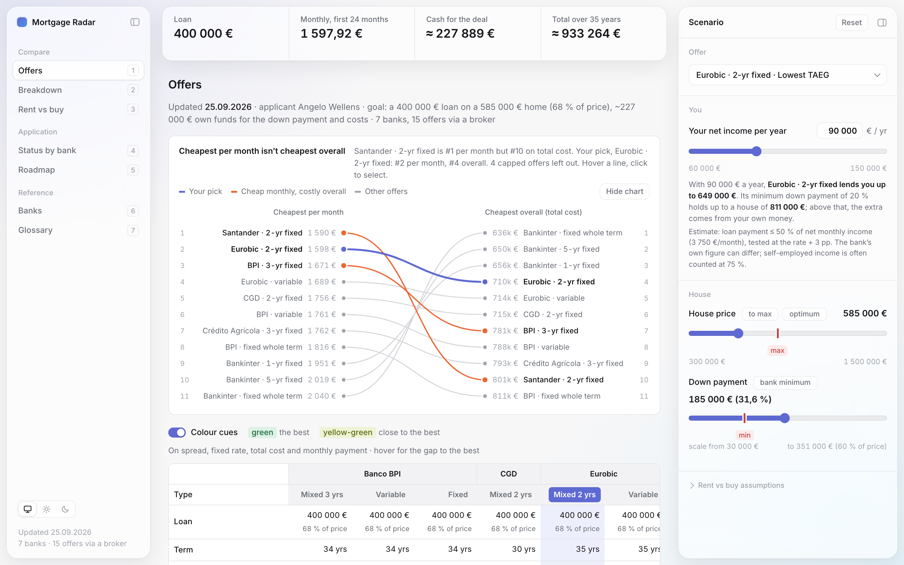

# Mortgage Radar

A single-page tool for comparing Portuguese mortgage offers — built to replace a broker's Excel sheet with something you can actually play with.

**Live:** https://angel-zero-star.github.io/mortgage-radar/



> Portfolio case study · names, dates and statuses adapted.

---

## The problem

A broker sent a comparison of **7 banks and 15 offers** for one scenario: a 585 000 € home with a 400 000 € loan. The spreadsheet answered one question well ("what does each bank offer for *this* house?") and nothing else:

- Different terms (25–35 years) made monthly payments look comparable when they weren't.
- One bank only lent 60 % of the price, hidden in a single grey cell.
- There was no way to ask *"what if the house costs 500 000 €?"* or *"what if I put more money down?"*

## What it does

An app with seven views in a sidebar, one shared scenario, and every number recalculated live.

- **Scenario panel** — house price, down payment, net income and the offer you're looking at, always one click away. The scenario lives in the link and in the browser, so a shared URL opens the same numbers.
- **Summary bar** — loan, monthly payment, cash for the deal and total over the term; when a slider moves, each figure flashes its change (+/−) so you see the effect of every decision.
- **Offers** — the broker's sheet, rebuilt and re-priced for your price and down payment: payments from each bank's own rates, taxes recalculated, insurance scaled, banks that won't lend that much marked **capped**. A slope chart puts *cheapest per month* next to *cheapest overall* — the offers that drop places are the ones the monthly payment flatters. Green marks the best value per row, yellow-green close behind; colour follows the value range, not the rank.
- **Income limit** — enter your net yearly income and each bank's maximum loan is estimated with the Banco de Portugal rule; the sliders show the resulting **MAX** / **MIN** instead of error messages.
- **Breakdown** — one offer in detail: where the deal cash goes (down payment, IMT, stamp duties, fees), the monthly payment before and after the fixed period, principal vs interest year by year, the remaining loan, and when each payment falls due.
- **Rent vs buy** — a month-by-month simulation with adjustable rent, horizon, house-price growth, return on savings and rent growth, charted as who's ahead over time.
- **Status by bank, Roadmap, Banks, Glossary** — where each application stands, the steps from offer to keys, each bank in detail, and the terms (TAEG, MTIC, IMT…) explained.
- **Details** — keyboard shortcuts (1–7 views, `[` `]` panels, `T` theme, `R` reset), System / Light / Dark, hover tooltips on every chart, and a layout that becomes a bottom sheet on a phone.

## How it works

### The loan is whichever limit bites first

```js
const loan = Math.min(
  price - down,          // what you're asking for
  bank.ltv * price,      // the bank's % of the price (e.g. 80 %)
  incomeCap(bank, income)// what your income can carry
);
```

This one line is why the price and down-payment sliders interact: past a certain price, the loan stops growing and every extra euro comes from your own money. The sliders show those limits as **MAX** / **MIN** markers instead of error messages.

### Turning a regulator's rule into code

```js
// Banco de Portugal: the loan payment may be at most 50 % of net monthly income,
// tested as if the rate were 3 points higher. Fixed-for-life rates aren't stress-tested.
const DSTI = 0.50, STRESS = 0.03;

function incomeCap(bank, netYearlyIncome) {
  const maxPayment = netYearlyIncome / 12 * DSTI;
  const fixedForLife = bank.fixm >= bank.months;
  const r = (fixedForLife ? bank.r1 : Math.max(bank.r1, bank.r2) + STRESS) / 12;
  return maxPayment * (1 - Math.pow(1 + r, -bank.months)) / r;
}
```

### One config entry per offer

Every button, table column and tooltip is generated from data like this — adding an offer is one entry, not a redesign:

```js
bankinterFix: { bank: 'Bankinter', type: 'Fixed', kind: 'fixed',
  months: 300, r1: 0.0269, life: 166.81, home: 39.97, fees: 1825.03,
  taeg: 0.042, mtic: 636154.75, base: 400000, ltv: 0.80 }
```

## Verified against the source

At the broker's own scenario (585 000 € home, 400 000 € loan) the tool reproduces the spreadsheet **to the cent**:

- every monthly payment, for all 15 offers;
- every "total costs including taxes" figure — IMT, both stamp duties and each bank's fees add up exactly.

Checking the numbers also surfaced something the spreadsheet hid: two offers with near-identical rates and payments had total costs ~91 000 € apart — a gap the monthly figures can't explain, pointing to costs (insurance rising with age, required products) that only show up in the TAEG and MTIC.

## Built with

- Plain HTML, CSS and JavaScript in a single file — no framework, no build step, no dependencies; charts are hand-written SVG.
- Designed and directed by me; built with **Claude Code**. I set the product direction and the design system (a Linear-style app shell, glass panels, one accent colour), and Claude Code wrote the implementation, iterating on screenshots I reviewed on localhost.
- The numbers were checked, not assumed: the tool reproduces the broker's spreadsheet to the cent, and the chart palette was validated for colour-blind readers.
- The demo videos on my portfolio are rendered with Remotion driving the real app frame by frame — no screen recording.

## Notes

Rates, fees and insurance figures come from a real broker comparison (September 2026); applicant details and application statuses have been adapted. Income limits are an estimate of the Banco de Portugal rule — each bank's own calculation differs. Not financial advice.
